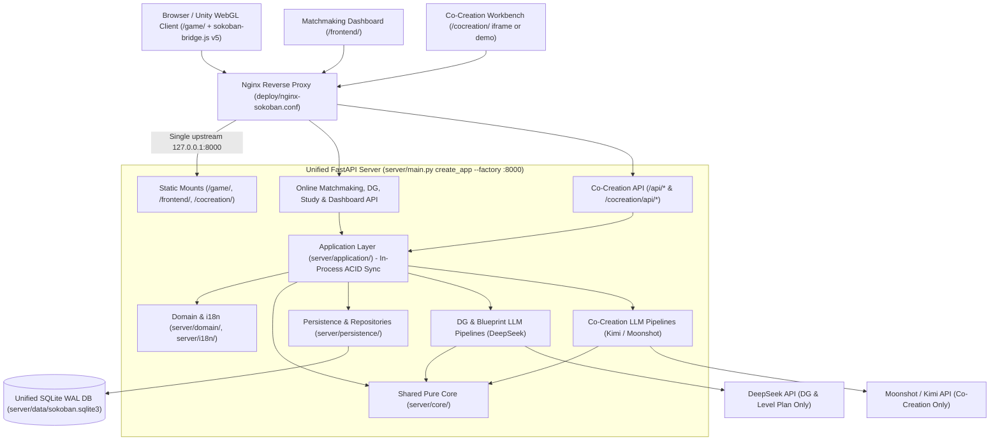

# SURF Unified Platform Architecture

This document describes the unified single-server architecture for the **SURF Sokoban Human-AI Co-Creation & Online Challenge** platform. All online matchmaking, Description Generation (DG), study logging, dashboard projection, and human-AI co-creation workflows run inside a single Python 3.12 FastAPI server on port `8000`, backed by a unified SQLite WAL database and a modern TypeScript/Preact web workspace.

## High-Level Topology

## Module Layers

### 1. Shared Python Core (`server/core/`)

Pure Python 3.12 domain primitives inside `server/core/` with **zero FastAPI, SQL, or UI imports** (Unity `Packages/` contains only `manifest.json` and `packages-lock.json`):

- `grid.py`: Canonical 12×10 immutable `Grid` value object (`' '` void, `'#'` wall, `'.'` floor, `'@'` water, `'p'` player, `'s'` box, `'t'` target), `parse_grid`, canonical `outer_shell()` / `boundary_walls()`, `diff_grids`, `apply_operations` (strictly restricted to `add_wall`, `remove_wall`, `add_water`, `remove_water` — zero entity relocation), `replay_solution`, and SHA-256 `map_fingerprint`.
- `solver.py`: Fast `solve_min_steps` (BFS with precomputed static deadlock pruning, tuple goal checks, parent-pointer trace reconstruction, batched monotonic deadline checks) and lazy `solve_min_pushes` (invoked only when requirements explicitly mention pushes).
- `generator.py` & `_generator_templates.py`: Deterministic/seeded Sokoban level generator (`generate_demo_level`, `generate_level_candidate`, `GenerationCandidate`, `DemoLevel`) with static wall/shell/structure templates and bounded deadlines.
- `llm_client.py`: Native-async `LLMTransport` protocol and shared `AsyncOpenAITransport` (`httpx.AsyncClient` / `AsyncOpenAI`, closed cleanly on FastAPI lifespan shutdown), generic `call_structured` using strict Pydantic JSON Schema outputs, strict error taxonomy (`LLMValidationError`, `UpstreamLLMError`, `DeadlineExceededError` — never catching internal Python bugs as retryable LLM failures), and automatic secret redaction.
- `clock.py` & `settings.py`: `Clock` protocol (`SystemClock`, `FakeClock`), UTC ISO helpers, `BaseSokobanSettings`, `parse_allowed_origins`, `safe_compare_digest`, and `redact_secrets`.

### 2. Unified FastAPI Server (`server/`)

A single ASGI application factory (`server/main.py`, served via `uvicorn server.main:create_app --factory --port 8000`) wired via `server/settings.py` (reading unified root `.env` based on [.env.example](../.env.example)) and `server/container.py` (`AppContainer`) with explicit constructor dependency injection and clean layering:

- **Domain & i18n (`server/domain/`, `server/i18n/`)**: Typed models for online rooms (`rooms/` subpackage), blueprints (`blueprints/` subpackage), co-creation sessions/Stage snapshots (`sessions.py`), `DesignContext` memory (`memory/` subpackage), Policy 2 binary discovery / requirement contracts / bounded beam search (`proposals/` subpackage), structured domain errors (`errors.py`), and centralized bilingual messages (`server/i18n/messages.py`).
- **Native-Async LLM Layer (`server/llm/`)**:
  - `schemas.py`: Strict Pydantic v2 structured JSON output contracts (`ChatReplyPayload`, `TurnRoutingPayload`, `BinaryDiscoveryPayload`, `RequirementRecordPayload`, `RevisionPlanPayload`, `MapOperationsPayload`, `ManualEditReviewPayload`, `TranslationPayload`, `TranslationVerificationPayload`, `DGGuideSummaryPayload`, `LevelPlanPayload`), replacing legacy inline `<GUIDANCE>||` text scraping.
  - `prompts/`: Focused prompt modules (`chat.py`, `understanding.py`, `proposal.py`, `binary.py`, `translation.py`, `dg_guide.py`, `level_plan.py`).
  - `grounding.py`: Precompiled module-level regexes for deterministic entity/coordinate verification and coordinate-link extraction against `Grid`.
  - `pipelines/`: Async pipeline classes (`ChatPipeline`, `UnderstandingPipeline`, `ProposalPipeline`, `BinaryDiscoveryPipeline` [Policy 2 only], `TranslationPipeline` [independent generation & verification attempt budgets], `DGGuidePipeline`, `LevelPlanPipeline`). Zero `asyncio.run()`, zero daemon threads, zero ambient ContextVars.
  - **Strict Model Isolation**: DG guide and blueprint planning exclusively use DeepSeek configuration; co-creation chat, Policy 2 discovery, revision planning, and translation exclusively use Kimi/Moonshot configuration. Neither pipeline falls back to the other's credentials or consumes the other's internal context.
- **Application Layer (`server/application/`)**: Native-async services with zero FastAPI imports organized into five subpackages:
  - `rooms/` (`OnlineRoomService` + in-process ACID sync helpers), `study/` (`DGGuideService`, `LevelPlanService`, `StudyRecordsService`), `analytics/` (`DashboardService`), `sessions/` (`config.py` plus `lifecycle/`, `stage/`, and `read_model/` subpackages exporting `CoCreationAppSettings`, `SessionLifecycleService`, `StageService`, `SessionReadModelService`), and `dialogue/` (`DialogueOrchestrator`, `ProposalService`, `IntentService`, `RecoveryService`, `TranslationService`, plus `handlers/{binary_discovery,challenge,ordinary,revision_card}.py`).
- **HTTP API Routers (`server/api/`)**: Thin async routers (`deps.py`, `schemas.py`, `routers/{health,online,study,dashboard,sessions,stage,dialogue,proposals,integrations,play_attempts}.py`):
  - **Active Matchmaking, DG & Study Routes**:
    - Online rooms (`online.py`): `POST /online/rooms`, `POST /online/rooms/join`, `GET /online/rooms/{match_id}`, `POST /online/rooms/{match_id}/{ready,leave,draft,challenge,result}`
    - Initial design & study records (`study.py`): `POST /dg/guide/summary`, `POST /generate-level-plan`, `POST /record-survey-response`, `POST /record-level-start`, `POST /record-level-end`, `POST /record-journey-event`
    - Matchmaking Dashboard & export (`dashboard.py`): `/frontend/`, `GET /matchmaking-records-data`, `GET /matchmaking-records`, `POST /verify-dashboard-password`, `POST /delete-online-match`, `POST /clear-matchmaking-records`, `GET /export/study-logs.jsonl`
    - Health checks (`health.py`): `GET /health`, `GET /ready`, `GET /cocreation/health`, `GET /cocreation/ready`
  - **Active Co-Creation Routes** (mounted at `/api/*` and aliased at `/cocreation/api/*`, with workbench static files at `/cocreation/`):
    - Sessions & auth (`sessions.py`): `POST /api/sessions`, `POST /api/demo-sessions`, `POST /api/sessions/{id}/browser-access`, `GET /api/sessions/{id}`, `PATCH /api/sessions/{id}/language`, `POST /api/sessions/{id}/translations/{lang}`, `POST /api/sessions/{id}/finalize`, `POST /api/sessions/{id}/intention`
    - Stages & draft regenerations (`stage.py`, `integrations.py`): `POST /api/sessions/{id}/versions`, `POST /api/sessions/{id}/versions/{vid}/{restore,assessments,play-attempts}`, `POST /api/sessions/{id}/draft-regenerations`, `POST /api/sessions/{id}/draft-regenerations/{req_id}/cancel`, `GET /api/integrations/sessions/{id}`, `POST /api/integrations/sessions/{id}/draft-regenerations/{req_id}/{claim,complete,fail}`
    - Play attempts (`play_attempts.py`): `POST /api/play-attempts/{aid}/{bootstrap,start,progress,complete,abandon}`
    - Chat, Policy 2 binary discovery, proposals & recovery (`dialogue.py`, `proposals.py`): `POST /api/sessions/{id}/messages`, `POST /api/sessions/{id}/proposal-discovery/{choices,cancel}`, `POST /api/sessions/{id}/proposals/{pid}/decision`, `POST /api/sessions/{id}/questions/{qid}/feedback`, `POST /api/sessions/{id}/intent-hypotheses/{hid}/feedback`, `POST /api/sessions/{id}/component-recoveries/{rid}/retry`
  - **Retired Legacy Surfaces**: Legacy Train study routes (`Frontend/train.html`, `/level-records*`, `/survey-records*`, `/generate-pc-level`, `/validate-human-adjustment`, etc.) and Policy 1 text-clarification proposal branches are removed from the active server.
  - **In-Process ACID Synchronization**: Co-creation lifecycle events (`first_stage`, Stage updates, `final`) and self-reported `designer_intention` commit directly into `online_rooms` / `online_room_events` inside the unified SQLite database, removing cross-process HTTP sync loopbacks.
- **Offline CLI Tools & Evaluations (`server/tools/`, `server/evaluations/`)**: `python -m server.tools.reliability_report` (read-only SQLite reliability summary) and `python -m server.tools.semantic_eval validate` (offline synthetic evaluation suite validation against `server/evaluations/turn_understanding_v1.json`).

### 3. Unified Persistence (`server/persistence/`)

- **Engine**: Single SQLite database in WAL mode (`server/data/sokoban.sqlite3`), `PRAGMA foreign_keys=ON`, `PRAGMA busy_timeout=5000`, schema versioned via `PRAGMA user_version = 1` (zero cold-start table scans or implicit runtime backfills).
- **Transaction Discipline**: `write_tx()` acquires `BEGIN IMMEDIATE` exclusively for brief database commits (<10ms) and is never held across solver execution or external LLM calls.
- **Tables (`server/persistence/schema.py`) & Repositories (`server/persistence/repositories/{rooms_repo,study_repo,sessions_repo,dialogue_repo,operational_repo}.py`)**:
  - Online & study: `online_rooms`, `online_room_events`, `study_records`
  - Co-creation core: `design_sessions`, `level_versions`, `conversation_turns`, `change_proposals`, `revision_challenges`, `play_attempts`, `draft_regenerations`
  - Dedicated indexed operational tables (promoted out of `audit_events`): `idempotency_keys`, `binary_discovery_topics`, `component_recovery_tasks`
  - Telemetry: strictly append-only `audit_events` indexed on `(session_id, event_type, id)`
- **Migrations & Export**:
  - Standalone CLI (`python -m server.persistence.migrations`) imports legacy JSONL study logs (`--import-study-logs`) and/or migrates legacy co-creation SQLite databases (`--migrate-cocreation-db`).
  - `GET /export/study-logs.jsonl` streams study records in JSONL format for downstream research analysis.

### 4. Frontend Workspace (`web/`) & Unity WebGL Bridge

An npm workspace (`web/package.json`) using **Vite + TypeScript + Preact + `@preact/signals` + Zod**:

- `web/packages/ui-core` (`@sokoban/ui-core`): Canonical pixel-adventure design tokens (`tokens.css`), accessible 12×10 `SokobanMap` (readonly + event-delegated editor), native `<dialog>` `ConfirmDialog`, `NoticeBanner`, typed `fetchJson` / `ApiError` / `validateSafeNavigationUrl`, and canonical `PROTOCOL_VERSION = 5` bridge schemas (`src/bridge/protocol.ts`).
- `web/apps/dashboard`: Matchmaking Dashboard built to `web/dist/dashboard` and served at `/frontend/` (preserving static `/frontend/tutorial/Sokoban_Tutorial_Bilingual.pdf`). Uses `AbortController` request cancellation, signals-based live filtering, and JSONL export links.
- `web/apps/cocreation`: Bilingual (`en`, `zh-CN`) Co-Creation Workbench built to `web/dist/cocreation` and served at `/cocreation/`. Features modular Signal workflows under `src/store/workflows/`, server-anchored monotonic deadline countdowns, Policy 2 binary choice cards, structured revision/intent/disagreement cards, and protocol v5 iframe messaging.
- `web/apps/webgl-bridge`: Builds a self-contained IIFE bundle directly to `Assets/WebGLTemplates/SokobanPixel/TemplateData/sokoban-bridge.js`. Hosts the single `window` message router (strict origin allowlist rejecting `"null"`), deterministic iframe handshake, `ResizeObserver` lobby room-code overlay, native `<dialog>` dashboard password gate, and all `window.Sokoban*` / Unity `SendMessage` exports.

## Security & Authentication Model (Decision 5B)

| Surface | Policy |
| --- | --- |
| Dashboard & research reads | Local/research convenience reads (`/frontend/`, `/matchmaking-records-data`, `/export/study-logs.jsonl`) remain open without client-side `?access=1` theater; WebGL template `DATA DASHBOARD` button retains the password gate (`POST /verify-dashboard-password`) for participant separation. |
| Destructive Dashboard deletes | `POST /delete-online-match` and `POST /clear-matchmaking-records` require `X-Delete-Password`, verified in constant time via `safe_compare_digest`. |
| Co-creation sessions | Hashed random per-session secrets (`secret_hash`, `access_token_hash`, `integration_token_hash`, `bootstrap_token_hash`); browsers use `HttpOnly` session cookies scoped cleanly; Unity uses scoped integration tokens; server logs a prominent startup warning whenever the default `TOKEN_SECRET` is active. |
| Demo session hygiene | `algorithm_demo` sessions expire by TTL (`delete_expired_demo_sessions`) rather than wiping active concurrent demos or touching formal study rows. |
| Reverse proxy & logs | `deploy/nginx-sokoban.conf` hardens `X-Forwarded-Proto` via trusted proxy CIDRs (falling back safely to `$scheme`). All error/log pipelines pass through `server.core.settings.redact_secrets`. |

## Deployment Layout (`deploy/`)

- `deploy/nginx-sokoban.conf`: Single upstream `127.0.0.1:8000` (`keepalive 16`), 135s read/send timeout for `/cocreation/` LLM turns, `no-cache` on `index.html`, hardened `X-Forwarded-Proto`.
- `deploy/sokoban.service`: Non-root systemd unit (`User=sokoban`, `NoNewPrivileges=true`, `PrivateTmp=true`) running `.venv/bin/uvicorn server.main:create_app --factory --host 127.0.0.1 --port 8000` with `EnvironmentFile=-/opt/sokoban/.env`.
- `deploy/Dockerfile` & `deploy/compose.yaml`: Multi-stage `node:22-alpine` + `python:3.12-slim` non-root container (`appuser`) running `uvicorn server.main:create_app --factory --host 0.0.0.0 --port 8000` with `/health` check and persistent SQLite volume mount.
- `deploy/deploy.ps1`: PowerShell release script using SSH alias `sokoban` and `%USERPROFILE%\.ssh\sokoban` (`IdentitiesOnly=yes`), local web build, `-WhatIf` dry-run support, `sokoban.service` restart, and post-deploy `/health` + `/ready` verification.

Related specifications live in [STUDY_PROTOCOL.md](STUDY_PROTOCOL.md), [REPLY_RELIABILITY.md](REPLY_RELIABILITY.md), and [archive/multi-agent/](archive/multi-agent/).
